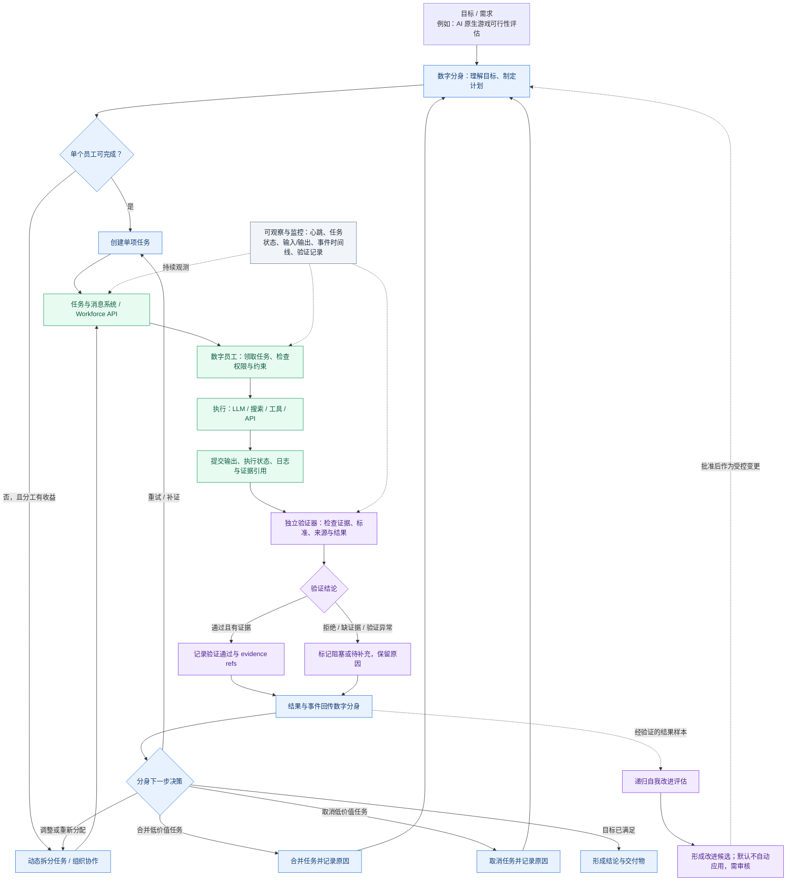

# 数字分身与数字员工：信息流与协作流程

> 本图是逻辑架构图，不代表所有组件均已上线。以代码、API、事件记录和自动化测试的实际结果判断实现状态。

## 协作流程图

## 信息流说明

1. **目标流**：用户目标进入数字分身；分身先判断单代理是否足够，避免无必要的多员工协作。
2. **任务流**：任务包含目标、描述、能力要求、优先级、成功标准、证据要求和权限约束，经 Workforce API 进入队列。
3. **执行反馈流**：员工返回输出、状态、阻塞原因和可追溯的证据引用。执行完成不自动等于结果可信。
4. **验证流**：验证器按成功标准检查输出；需要证据时，没有有效证据不得标记验证通过。验证拒绝、异常和缺证据都要留痕。
5. **重规划流**：分身根据验证结果与运行状态，选择重试、补证、重新分配、合并、取消或结束任务，并记录决策原因。
6. **监控流**：心跳、任务状态、输入输出、验证记录和事件时间线用于查看具体过程；监控本身不替代业务判断。
7. **递归自我改进**：只用严格验证过的结果作为评估样本。候选改进需满足样本量、收益门槛和无回归等约束；默认不自动应用，须经审核与回滚机制。

## 目前已知的实现边界

- 已有：数字分身的任务规划/监督接口、Workforce 队列相关方法、状态监控与验证辅助逻辑，以及有界的递归自我改进评估。
- 已推进：项目循环增加独立 verifier 注入点；验证通过要求 `accepted is True` 且返回非空 `evidence_refs`；无 verifier 时区分“执行完成”和“已验证”。
- 仍需持续验证：端到端员工执行与回传、API 持久化验证记录与事件链的一致性、真实工具调用和 AI 原生游戏评估流程。
- 改进评估不应把模型自述或未验证输出当作成功证据。

## 调试入口

在支持对应接口的运行环境中，可从任务详情、员工状态、验证记录与事件时间线检查一次任务的完整链路。若提供 `/trace` 端点，应将它作为观测视图而非独立的事实来源；展示内容应链接到真实任务 ID 和持久化事件。
