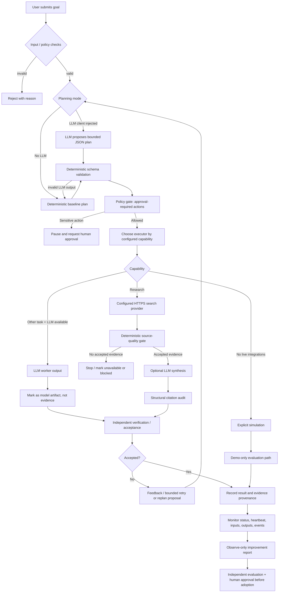
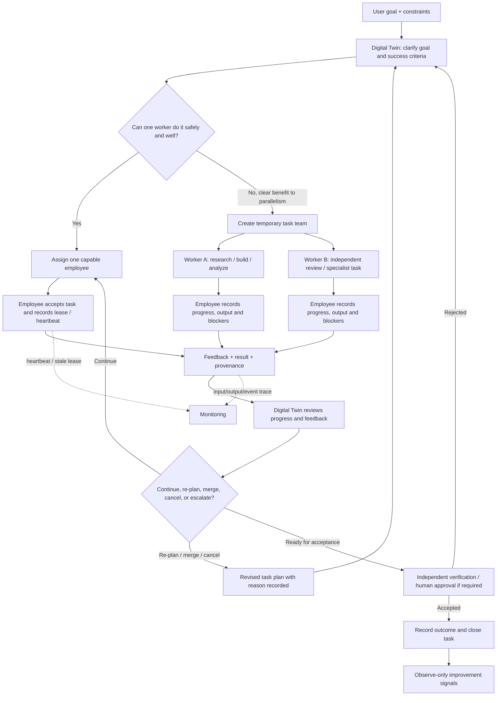
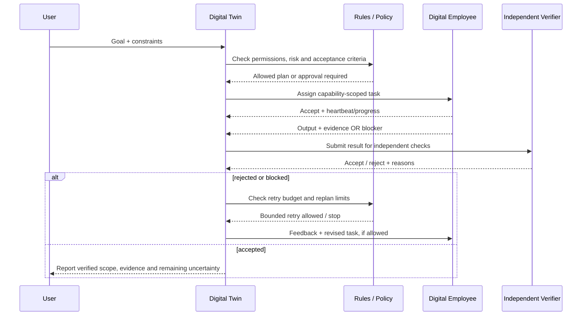

# JARVIS overall logic flow and LLM timing

> Status note: this document describes the current MVP code paths, not a claim that every path is deployed or wired into one production runtime. The dashboard executor and the persistent workforce API are separate surfaces today. Keep their statuses and capabilities distinct until an end-to-end integration test proves the whole path.

## 1. High-level flow

## 2. Digital Twin and digital employee collaboration

The Digital Twin is the goal owner and dynamic coordinator; employees are task-scoped workers, not permanently fixed job titles. The Twin should first ask whether one capable worker can complete the goal. It creates a multi-worker plan only when parallelism, independent review, or specialized capabilities provide a clear benefit.

### Responsibilities and boundaries

- **Digital Twin (goal owner):** maintains the goal and acceptance criteria; decomposes work only as needed; monitors worker progress; consumes blockers and proposals; can re-plan, merge or cancel low-value tasks when the relevant orchestration path is wired and permitted. It must record why it changed the plan.
- **Digital employee (task worker):** accepts only authorized tasks matching its configured capabilities; reports progress, blockers, output and provenance; cannot validate its own result as trusted truth or grant itself permissions.
- **Independent acceptance:** evaluates the result against the goal and evidence requirements. Worker completion is a lifecycle event, not proof of correctness.
- **Monitoring:** tracks state transitions, heartbeat freshness, inputs/outputs, events and validation decisions. A heartbeat proves recent liveness only, not useful work or correctness.
- **Team formation:** default to one worker. Add more only when the expected quality, speed or risk reduction justifies the extra coordination and cost.

### Where rules and LLMs affect the Twin/employee loop

| Moment | Rule / code behavior | Possible LLM behavior |
|---|---|---|
| Goal intake | Validate required goal, constraints, permissions and acceptance criteria | Ask clarifying questions or suggest measurable success criteria when an LLM is configured |
| Decomposition | Enforce capability allowlist, task limits, dependency validity and approval policy | Propose task breakdown and temporary team composition |
| Assignment | Match capability, task status, lease and worker availability | Recommend a worker only if the orchestration implementation explicitly asks the model |
| Worker execution | Enforce state transitions, lease/fencing, attempt limits and event schema | Generate research synthesis, code, analysis or other task artifacts via configured executor |
| Feedback / replanning | Preserve state history; bound retries; reject unauthorized transitions | Interpret blocker reports and propose continue, merge, cancel, escalate or re-plan actions |
| Acceptance | Enforce required fields, evidence records, reviewer separation and approval gates | Assist an independent reviewer only when explicitly configured; never self-approve |
| Learning loop | Aggregate historical outcomes and require thresholds | Current improvement report makes no LLM call and takes no action; later experiments need independent evaluation and human approval |

### Current implementation caveat

The repository has a persistent workforce lifecycle and a separate dashboard/executor path. The admin-only `POST /api/twin/goal` endpoint connects a goal to the persistent employee mailbox: it defaults to one queued employee task (`strategy=single_agent`) and only decomposes into temporary tasks when the caller explicitly requests `strategy=decompose`. Decomposed tasks share a project ID in their acceptance metadata, and a `twin_goal_planned` event records the plan mode and created task IDs. The admin-only `POST /api/twin/review` endpoint reads task states and blockers and records a deterministic decision; it remains read-only and does not auto-retry or accept results. The admin-only `POST /api/twin/advance` endpoint can take at most one bounded action per call: it re-queues one blocked/failed task only when its blocker matches a small explicit list of transient infrastructure signals and its configured attempt budget remains. Unknown blockers remain blocked and require diagnosis; awaiting-validation results are never auto-accepted. Each advance writes a `twin_advanced` event with the decision, reason, task IDs, next actions, and `llm_used=false`. This is bounded deterministic autonomy, not a claim of continuous production operation: semantic replanning, automatic merge/cancel execution, and task-level LLM trace instrumentation remain follow-up work.

## 3. When deterministic rules run vs. when an LLM runs

| Stage | Deterministic rules / code | LLM call timing | Important boundary |
|---|---|---|---|
| Request intake | Required fields, type/length bounds, task schema | None | Reject invalid input before model work |
| Planning | Capability allowlist, unique IDs, max task count, JSON schema | Only if a caller supplies an LLM client to `plan_project` | If missing/invalid, fall back to deterministic plan |
| Approval | Compare requested actions to approval-required set | None | LLM cannot approve publishing, spending, destructive or legal actions |
| Worker dispatch | Capability router and configured executor | LLM executor runs for non-research tasks when configured | Model output is an artifact, not external evidence |
| Live research | Search endpoint, HTTPS response shape, title/URL/snippet checks, source-quality gate | Optional synthesis only after at least one finding passes the quality gate and LLM env is configured | No accepted evidence means synthesis is skipped |
| Citation audit | Check citation IDs and sentence-level citation presence | None | Structural citations do not prove a source semantically supports a claim |
| Output acceptance | Non-empty output, evidence record structure, configured criteria, provenance checks | Independent reviewer may be injected; no default claim that it ran | `verified_truth` remains false unless a trusted verification path explicitly establishes it |
| Failure recovery | Attempt limits, state transitions, bounded iterations | Optional replanner may propose replacements when injected and configured | A proposed replacement is not automatically proof the root cause is fixed |
| Recursive improvement | Aggregate recorded statuses, retries and blocker patterns; sample thresholds | None in the current observe-only report | Suggestions do not mutate tasks, prompts, permissions, code or deployment |

## 3. Configuration gates

### LLM worker / planning
The main dashboard creates an LLM client only when all three are non-empty:
- `JARVIS_LLM_BASE_URL`
- `JARVIS_LLM_API_KEY`
- `JARVIS_LLM_MODEL`

The LLM endpoint must use HTTPS. LLM planning occurs only in code paths that explicitly call `plan_project(goal, llm_client)`; passing no client uses deterministic planning.

### Live research
Live search requires:
- `JARVIS_SEARCH_ENDPOINT` set to an HTTPS JSON endpoint
- optional `JARVIS_SEARCH_API_KEY` for bearer authentication, depending on provider

Research capabilities fail closed if the search endpoint is missing. A general LLM answer must not be used as a substitute for search results.

### Research synthesis
LLM synthesis is attempted only after the deterministic evidence-quality gate accepts at least one source-backed finding and all LLM environment variables are configured. The result is marked review-required; citation structure is audited, but semantic support is not automatically verified.

## 4. What is already implemented vs. what still needs proof

Implemented in the current code paths:
- Deterministic input/schema and capability checks.
- Optional LLM planning with deterministic fallback.
- Configurable simulated, LLM and hybrid executors with provenance labels.
- Research adapter boundary and mechanical source-quality checks.
- Optional source-grounded LLM synthesis with citation-structure audit.
- Task status / heartbeat / event monitoring and an observe-only improvement report.
- Human-approval boundary for configured high-impact actions.

Not yet proven as one end-to-end production workflow:
- Every dashboard path is connected to the persistent workforce task lifecycle.
- Every task result has semantic evidence support independently verified by a separate trusted verifier.
- Real search provider and LLM credentials are configured in a running deployment.
- Recursive self-improvement automatically changes the system safely; current implementation intentionally does not self-modify.
- A full browser acceptance run from goal submission through retry, validation, and trace review.

## 5. Suggested manual walkthrough

1. Open the trace dashboard and connect with the admin token.
2. Inspect a task's input, output, provenance, state history, worker heartbeat and validation record.
3. Open the observe-only improvement panel and confirm it displays signals/proposals but performs no action.
4. Run once with no LLM/search configured: output must be visibly simulated or research must fail closed.
5. Configure a search provider; confirm research output contains HTTPS source records and that empty/invalid results do not become accepted evidence.
6. Configure an LLM; confirm planning/synthesis metadata identifies model use and model prose is not promoted directly to evidence.
7. Test a rejected result and bounded retry/replan; confirm the trace shows why it was rejected and who/what initiated the next step.
8. Verify high-impact actions pause for human approval.

## 6. Source files to inspect

- `mvp/server.py` — dashboard executor selection and execution.
- `mvp/planning.py` — LLM plan proposal, schema validation and deterministic fallback.
- `mvp/executor.py` — simulation, LLM and hybrid execution boundaries.
- `mvp/research.py` — live search adapter, evidence gate and optional synthesis.
- `mvp/claim_evidence.py` — citation-structure audit.
- `mvp/verification.py` — output acceptance checks and optional independent reviewer.
- `mvp/workforce.py` / `mvp/server.py` — persistent task lifecycle, events, heartbeat and validation; `POST /api/twin/goal` connects goals to the employee mailbox.
- `mvp/improvement.py` — observe-only recursive improvement proposals.

## 7. Digital Twin and Digital Employee: responsibilities and current integration boundary

### Digital Twin (goal owner / supervisor)
The Twin is responsible for:
1. Preserve the user's goal, constraints, priorities, and acceptance criteria.
2. Decide whether one capable worker is sufficient; use multiple workers only when parallelism or independent review has a clear benefit.
3. Create and assign work, receive worker progress/blockers, merge or cancel low-value work, and re-plan within bounded limits.
4. Keep decisions auditable: why this task was created, why a worker was selected, what evidence changed the plan, and who approved a gated action.
5. Treat worker completion as a submission, not acceptance; rely on independent validation before declaring success.

### Digital Employee (capability-bound executor)
A worker is not a fixed human job title. Each worker has a runtime identity, an explicit capability allowlist, and scoped tools. It must:
1. Claim only eligible tasks matching its authorized capabilities.
2. Acknowledge work and renew its lease/heartbeat while working.
3. Report progress, completion output, or a blocker with the lease token for that attempt.
4. Include source/evidence records when the task requires research evidence.
5. Accept feedback and retry only when the Twin/supervisor explicitly re-queues the task within the attempt limit.

### Shared closed-loop view

### Important current implementation boundary

The repository currently contains **two related but not yet fully unified execution paths**:

- `POST /api/autonomous` runs a bounded project loop through the configured `WORKER_EXECUTOR`. It can call LLM planning/replanning when a client is configured, and its current default can be simulated.
- `/api/workforce/*` and `WorkforceRegistry` implement a persistent task mailbox, worker capability filtering, lease tokens, heartbeat, worker reports, feedback, retries, cancellation, merging, and verification records.
- `/trace` reads the persistent workforce API. It does not yet prove that every task created by `/api/autonomous` is automatically mirrored into the persistent workforce registry or that every result traverses one shared independent-verification pipeline.

Therefore, do not treat the separate pieces as a proven end-to-end Digital Twin + Employee runtime yet. The next integration milestone should unify goal/planning events with persistent worker tasks, link every task to its originating goal and plan version, and make the trace view show Twin decisions and employee actions on one correlated timeline. Add an end-to-end test that verifies: goal → plan → assigned worker → progress/heartbeat → blocker or output → Twin feedback/replan → independent acceptance → final report.

### What the user should be able to inspect

For each run, the trace view should expose:
- **Twin decisions:** goal interpretation, single-agent vs multi-agent choice, task creation/merge/cancel/replan reasons, approval gates, and next-step decision.
- **Employee execution:** worker identity, authorized capabilities, input, tool/LLM mode, progress, heartbeat, output, blocker and lease/attempt number.
- **Rules:** which validation or policy rule ran, its result, and whether it blocked or allowed the next transition.
- **LLM calls:** exact stage (planning, execution, synthesis, or re-planning), model/configuration label, sanitized prompt/input reference, output reference, duration, error/fallback, and provenance. Never log API keys or secrets.
- **Acceptance:** verifier identity/type, criteria checked, evidence references, rejected claims, decision and unresolved uncertainty.

An LLM call should be represented as an event only when the code actually invokes the configured client. A configured model, a planned model step, or a simulated output must never be presented as a completed live LLM call.
