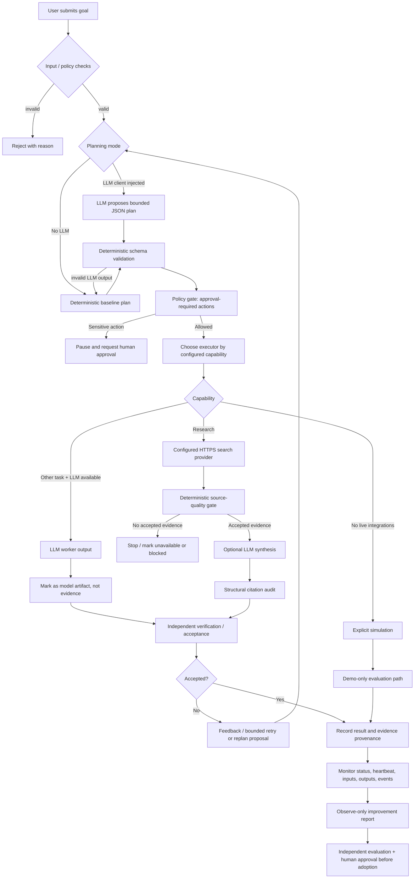

# JARVIS overall logic flow and LLM timing

> Status note: this document describes the current MVP code paths, not a claim that every path is deployed or wired into one production runtime. The dashboard executor and the persistent workforce API are separate surfaces today. Keep their statuses and capabilities distinct until an end-to-end integration test proves the whole path.

## 1. High-level flow

## 2. When deterministic rules run vs. when an LLM runs

| Stage | Deterministic rules / code | LLM call timing | Important boundary |
|---|---|---|---|
| Request intake | Required fields, type/length bounds, task schema | None | Reject invalid input before model work |
| Planning | Capability allowlist, unique IDs, max task count, JSON schema | Only if a caller supplies an LLM client to `plan_project` | If missing/invalid, fall back to deterministic plan |
| Approval | Compare requested actions to approval-required set | None | LLM cannot approve publishing, spending, destructive or legal actions |
| Worker dispatch | Capability router and configured executor | LLM executor runs for non-research tasks when configured | Model output is an artifact, not external evidence |
| Live research | Search endpoint, HTTPS response shape, title/URL/snippet checks, source-quality gate | Optional synthesis only after at least one finding passes the quality gate and LLM env is configured | No accepted evidence means synthesis is skipped |
| Citation audit | Check citation IDs and sentence-level citation presence | None | Structural citations do not prove a source semantically supports a claim |
| Output acceptance | Non-empty output, evidence record structure, configured criteria, provenance checks | Independent reviewer may be injected; no default claim that it ran | `verified_truth` remains false unless a trusted verification path explicitly establishes it |
| Failure recovery | Attempt limits, state transitions, bounded iterations | Optional replanner may propose replacements when injected and configured | A proposed replacement is not automatically proof the root cause is fixed |
| Recursive improvement | Aggregate recorded statuses, retries and blocker patterns; sample thresholds | None in the current observe-only report | Suggestions do not mutate tasks, prompts, permissions, code or deployment |

## 3. Configuration gates

### LLM worker / planning
The main dashboard creates an LLM client only when all three are non-empty:
- `JARVIS_LLM_BASE_URL`
- `JARVIS_LLM_API_KEY`
- `JARVIS_LLM_MODEL`

The LLM endpoint must use HTTPS. LLM planning occurs only in code paths that explicitly call `plan_project(goal, llm_client)`; passing no client uses deterministic planning.

### Live research
Live search requires:
- `JARVIS_SEARCH_ENDPOINT` set to an HTTPS JSON endpoint
- optional `JARVIS_SEARCH_API_KEY` for bearer authentication, depending on provider

Research capabilities fail closed if the search endpoint is missing. A general LLM answer must not be used as a substitute for search results.

### Research synthesis
LLM synthesis is attempted only after the deterministic evidence-quality gate accepts at least one source-backed finding and all LLM environment variables are configured. The result is marked review-required; citation structure is audited, but semantic support is not automatically verified.

## 4. What is already implemented vs. what still needs proof

Implemented in the current code paths:
- Deterministic input/schema and capability checks.
- Optional LLM planning with deterministic fallback.
- Configurable simulated, LLM and hybrid executors with provenance labels.
- Research adapter boundary and mechanical source-quality checks.
- Optional source-grounded LLM synthesis with citation-structure audit.
- Task status / heartbeat / event monitoring and an observe-only improvement report.
- Human-approval boundary for configured high-impact actions.

Not yet proven as one end-to-end production workflow:
- Every dashboard path is connected to the persistent workforce task lifecycle.
- Every task result has semantic evidence support independently verified by a separate trusted verifier.
- Real search provider and LLM credentials are configured in a running deployment.
- Recursive self-improvement automatically changes the system safely; current implementation intentionally does not self-modify.
- A full browser acceptance run from goal submission through retry, validation, and trace review.

## 5. Suggested manual walkthrough

1. Open the trace dashboard and connect with the admin token.
2. Inspect a task's input, output, provenance, state history, worker heartbeat and validation record.
3. Open the observe-only improvement panel and confirm it displays signals/proposals but performs no action.
4. Run once with no LLM/search configured: output must be visibly simulated or research must fail closed.
5. Configure a search provider; confirm research output contains HTTPS source records and that empty/invalid results do not become accepted evidence.
6. Configure an LLM; confirm planning/synthesis metadata identifies model use and model prose is not promoted directly to evidence.
7. Test a rejected result and bounded retry/replan; confirm the trace shows why it was rejected and who/what initiated the next step.
8. Verify high-impact actions pause for human approval.

## 6. Source files to inspect

- `mvp/server.py` — dashboard executor selection and execution.
- `mvp/planning.py` — LLM plan proposal, schema validation and deterministic fallback.
- `mvp/executor.py` — simulation, LLM and hybrid execution boundaries.
- `mvp/research.py` — live search adapter, evidence gate and optional synthesis.
- `mvp/claim_evidence.py` — citation-structure audit.
- `mvp/verification.py` — output acceptance checks and optional independent reviewer.
- `mvp/workforce.py` / `mvp/server.js` — persistent task lifecycle, events, heartbeat and validation.
- `mvp/improvement.py` — observe-only recursive improvement proposals.
