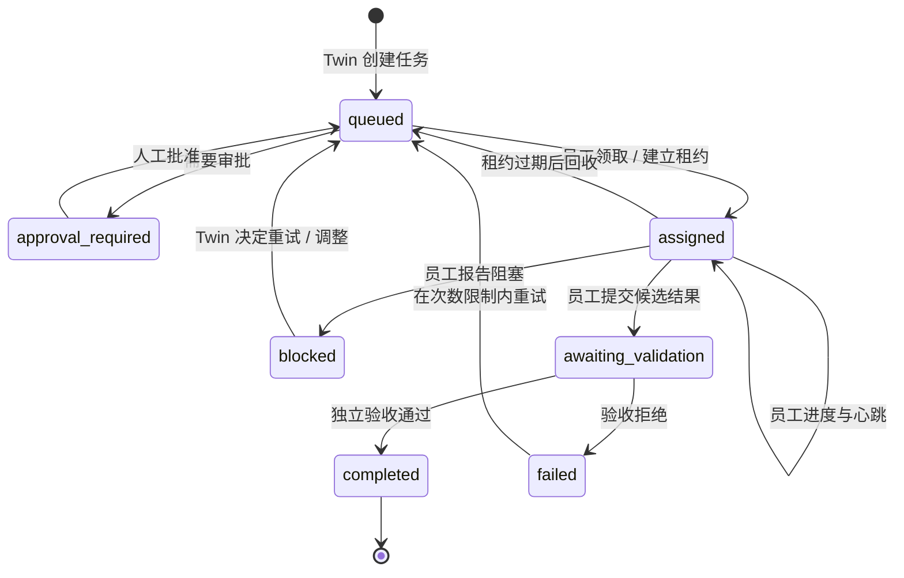

# 数字分身 ↔ 数字员工：核心闭环与验收清单

本文用于实际验收数字分身与数字员工的职责、状态、反馈关系，以及确定性规则和 LLM 的调用边界。它是测试计划，不代表尚未执行的场景已经通过。

## 1. 两个主体分别负责什么

### 数字分身（Twin / Supervisor）
- 持有用户目标、成功标准、优先级和风险边界。
- 决定先由单个员工完成，还是有明确收益时才拆成多个任务。
- 按员工能力、权限和运行状态分配任务；不应仅凭岗位名称分配。
- 监控员工心跳、任务租约、进度、输出和阻塞反馈。
- 对反馈作出可追踪决策：继续、补充输入、调整范围、合并任务、取消低价值工作、有限重试或提出重规划。
- 组织独立验收；员工报告 completed 不等于任务已通过验收，更不等于事实已被证实。
- 记录决策理由、替代方案和结果，供后续观察式改进使用。

### 数字员工（Worker）
- 暴露经服务端配置的能力和权限；客户端自行声称有某项能力不能扩大权限。
- 领取与能力匹配、且分配给自己的任务。
- 使用当前租约令牌汇报进度、结果或阻塞原因。
- 不得冒充其他员工、延长无效租约、验收自己的结果，或把输出直接标记为事实已验证。
- 结果提交后等待分身/有权验收者做出接受或拒绝决定。

## 2. 建议的核心状态流

注意：不同代码路径目前仍并存。这个状态图是验收目标；必须逐个测试实际 API/执行器的状态变更，不能假定所有入口共用同一个状态机。

## 3. 验收矩阵

| 场景 | 触发动作 | 必须观察到的结果 | LLM 是否必须 |
|---|---|---|---|
| Twin 创建目标 | 提交目标与成功标准 | 目标、约束和事件被记录；无效输入被拒绝 | 否 |
| 单员工优先 | 提交可由单一能力完成的任务 | 不无故扩张团队；任务有负责人/能力要求 | 规划可选 |
| 动态组队 | 任务确实需要互补能力 | 分工有理由、子任务可追踪，避免重复工作 | 可选 |
| 员工领取 | 匹配能力并领取任务 | 服务端验证身份、能力和任务状态，产生租约 | 否 |
| 进度反馈 | 员工提交进度 | Twin 侧可看到状态/事件/时间戳，租约按规则续期 | 否 |
| 阻塞反馈 | 员工提交 blocker | 任务进入阻塞；Twin 明确决定补充信息、重试或重规划 | 可选 |
| 候选结果 | 员工报告完成 | 进入待验收状态，不能直接等同已验收 | 否 |
| 独立验收 | 验收者检查结果和证据 | 接受/拒绝及理由留痕；员工不能自验收 | 可选，不能默认已运行 |
| 重试/重规划 | 失败且仍有尝试额度 | 旧尝试留痕、次数受限、新方案有替代理由 | 可选 |
| 高影响动作 | 发布、花费、破坏性操作等 | 在执行前暂停并请求人工批准 | 否 |
| 递归改进 | 多次任务失败或阻塞 | 产生有限、可证伪的改进建议，不自动改任务/代码 | 否 |
| 失联恢复 | 员工心跳/租约过期 | 标记 stale、回收或阻塞任务并记录事件 | 否 |

## 4. LLM 调用必须可观测

每次模型调用应尽可能留下以下元数据（不得记录 API 密钥或不必要的敏感内容）：
- `stage`: planning / execution / synthesis / replanning / independent_review
- `provider` 与 `model`：实际使用的配置标识
- `trigger`: 为什么需要调用模型
- `input_ref` / `output_ref`: 可审计的输入输出引用或脱敏摘要
- `fallback`: 是否回退到确定性逻辑，以及原因
- `duration_ms`、`status`、`error_class`
- `task_id`、`attempt`、`trace_id`

若调用方没有注入模型客户端，必须显示“未调用 LLM / deterministic fallback”，不能把规则输出伪装成模型输出。模型生成的文字也不能作为外部证据来源。

## 5. 当前已覆盖的自动化检查

现有测试已覆盖部分核心路径，例如：
- Twin 的策略快照、按目标筛选候选团队；
- 项目循环遇到失败时调用注入的 replanner 并记录 plan revision；
- 高影响动作在执行前被审批门槛拦截；
- 员工领取、进度、提交结果、管理员验收的 HTTP 闭环；
- 租约令牌、员工身份和能力边界；
- 心跳、阻塞任务、递归改进报告权限和只读行为。

这些测试并不自动证明：分身策略与持久化员工队列已在同一运行链路中完全集成、LLM 每次调用均被统一追踪、外部证据在语义上真实支持结论。以上仍需端到端验收。

## 6. 给用户的可视化验收步骤

1. 打开工作台，提交一个低风险目标。
2. 打开流程追踪，检查分身的计划、员工身份/能力、任务分配理由、状态和事件时间线。
3. 让员工报告一次进度，再报告一个阻塞原因；确认分身看到反馈后作出有理由的下一步决策。
4. 提交候选结果，确认它先进入待验收而不是直接标记为事实正确。
5. 由独立验收者接受或拒绝，并查看验收理由与证据引用。
6. 触发一次受控失败，确认重试次数有限且重规划产生可审计事件。
7. 在 LLM 未配置的情况下重复规划，确认界面清楚标注规则回退；配置 LLM 后确认真实调用元数据被记录。
8. 检查递归改进面板，确认它只提出建议，不自行执行修改。

## 7. 下一阶段的实现优先级

1. 为 Twin 决策建立统一的结构化事件：`decision`, `reason`, `alternatives`, `trigger`, `llm_used`, `policy_checks`。
2. 将持久化 Workforce 状态与项目循环的任务/trace 视图明确关联，避免两个并存路径被误认为一条完整生产链路。
3. 给 LLM 规划、执行、研究总结和重规划统一增加调用追踪。
4. 增加真实 provider 的端到端测试；无凭证时用 mock 测试并明确标注，不伪造真实调用。
5. 完成验收矩阵后，再考虑扩大自主权限；不得把递归改进直接升级为自动修改生产代码。
