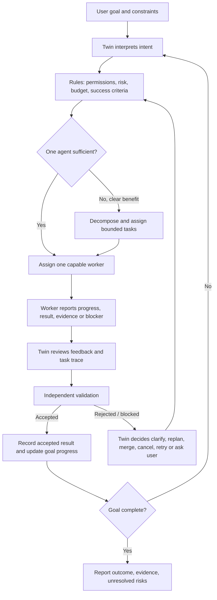

# Digital Twin ↔ Digital Employee: interaction contract

## Purpose

The Digital Twin and Digital Employees are the core actors of JARVIS. They are not merely labels on a dashboard, nor fixed human job titles. The Twin owns the goal and coordination policy; workers are configurable execution agents with explicit capabilities and permissions.

## Responsibilities

### Digital Twin — goal owner and supervisor
- Preserve the user's goal, constraints, definition of done, risk tolerance, and approved autonomy level.
- Decide whether one capable agent is enough. Start with one worker by default; create parallel workers only when decomposition has a clear quality, latency, or risk benefit.
- Turn the goal into small tasks with explicit inputs, outputs, acceptance criteria, evidence requirements, and allowed tools.
- Select or configure workers based on capability and permission, not on a rigid org chart.
- Monitor worker status, heartbeat/lease, progress, outputs, questions, blockers, and evidence.
- Interpret feedback and choose a recorded next action: answer the worker, clarify the task, revise the plan, merge redundant tasks, cancel low-value work, retry within limits, or ask the user.
- Never treat a worker's self-reported completion as acceptance. Send the candidate result through independent validation.
- Keep an auditable decision record explaining what changed, why, and whether an LLM or deterministic rule produced the proposal.

### Digital Employee — bounded execution agent
- Advertise only server-authorized capabilities and use only permitted tools.
- Accept a task only when assigned/eligible, then report progress with the current lease/fencing token.
- Return structured output, source records where required, uncertainties, assumptions, and blockers/questions.
- Request clarification or permission rather than silently expanding scope.
- Treat task completion as a candidate result. It remains awaiting validation until an authorized validation decision is recorded.
- Never approve its own result, impersonate another worker, extend an expired lease, or change its own permissions.

## Interaction loop

## When rules and LLMs act

| Decision point | Deterministic rules | LLM (conditional) |
|---|---|---|
| Understand request | Validate schema, size, auth, allowed autonomy | Interpret ambiguity, summarize intent, propose clarifying questions |
| Plan | Enforce capability allowlist, task bounds, approvals and acceptance fields | Propose decomposition, dependencies, priorities and success criteria |
| Assign | Enforce worker identity, capabilities, leases, task state and limits | Recommend a worker based on task semantics if a configured planner is called |
| Execute | Tool allowlists, timeouts, output size and state transitions | Produce research synthesis, analysis, code/design artifacts when the configured executor invokes it |
| Feedback | Record event; enforce retry/iteration caps | Classify blocker, suggest clarification or revised plan when a replanner is configured |
| Validate | Required fields, evidence structure, state and authorization checks | Optional independent review only when explicitly wired; never self-approve |
| Learn | Aggregate outcomes and thresholds | May later help explain patterns, but only as a proposal generator |
| Adopt changes | Regression gates, permission checks, approval and rollback policy | May propose a change; cannot enact it autonomously in the current observe-only stage |

## State and evidence contract

- Worker states such as queued, assigned/running, blocked, failed and awaiting validation are operational state, not quality labels.
- A heartbeat proves recent contact only; it does not prove useful work or correctness.
- A task marked completed after validation means the acceptance workflow approved the task; verified_truth remains false unless a separate trusted factual-verification path establishes truth.
- LLM output, worker claims and search snippets are separate provenance types. They must not be silently promoted to verified evidence.
- Every important Twin decision should eventually record: trigger/event, observed task IDs, rule checks, optional model-call metadata, decision, rationale, approval actor, and resulting state changes.

## Current implementation status

Already present in the repository:
- A DigitalTwin policy object and bounded AutonomousProjectLoop with approval gates and optional replanning.
- A durable workforce mailbox with capability checks, leases/fencing, progress/result/blocker reports, feedback, task history, and event stream.
- An authenticated API happy-path test covering Twin/admin task creation → worker claim/progress/result → validation.
- Trace dashboard for worker state, task input/output, heartbeat and event history.

Still incomplete / must not be implied as done:
- The dashboard execution path, autonomous project loop and persistent workforce mailbox are not yet one unified runtime.
- The Twin's feedback-driven decisions are not all represented as a single first-class decision policy/API with traceable reasons.
- LLM call traces (phase/model/input-output summaries/duration/cost) need to be unified across all execution paths.
- Independent semantic evidence verification needs a trusted provider/reviewer and dedicated tests.
- A full browser acceptance walkthrough against a running deployment has not yet been completed.

## Acceptance checklist for the next end-to-end test

1. Twin receives a goal and records constraints / done criteria.
2. Twin chooses single-agent mode unless parallelization has an explicit benefit.
3. Task includes capability, input, output schema, success criteria, evidence policy and tool permissions.
4. Worker can only claim work allowed by server-side capability policy.
5. Worker progress, questions, blockers, output and heartbeat appear in the trace.
6. Twin makes a recorded decision after feedback; retries and plan revisions are bounded.
7. Worker cannot self-approve; rejected results are returned with actionable feedback.
8. Final report distinguishes accepted output from verified facts and lists unresolved risks.
9. Trace identifies which decisions were deterministic and which actually invoked an LLM.
