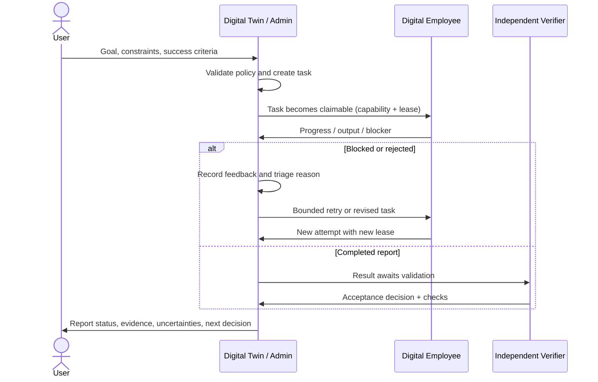

# Digital Twin ↔ Digital Employee operating model

This document makes the two core actors explicit. It distinguishes the currently implemented mailbox protocol from the higher-level autonomous decision loop that still needs end-to-end proof.

## Actor responsibilities

### Digital Twin (orchestrator)
- Owns the goal, task records, priorities, assignment policy, retries, merges/cancellations, and acceptance decision.
- Reads employee progress, blockers, output, lease/heartbeat state, and verification results.
- Records feedback and a reason for operational decisions.
- Re-plans only within bounded iteration/attempt limits; asks the user for approval when policy requires it.
- Does not treat an employee's completion report as proof that the result is correct.

### Digital Employee (worker)
- Has an authenticated worker identity and server-assigned capability allowlist.
- Claims only eligible work within its capabilities and receives a lease token.
- Reports progress, completion, or a blocker using the current lease.
- May send output and evidence records, but cannot approve its own result or impersonate another worker.
- Must not be treated as active solely because a stale or unauthorized heartbeat is received.

### Independent verifier / acceptance gate
- Checks the recorded output against the acceptance contract and evidence requirements.
- A successful structural review means the recorded checks passed; it does not automatically establish factual truth.
- `verified_truth` remains false unless a trusted verification path explicitly establishes it.

## Observable task loop

## Rule and LLM timing across the two actors

| Moment | Deterministic rule | LLM role |
|---|---|---|
| Before task creation | Validate input bounds, capabilities, approval requirements | May help interpret a natural-language goal if the planning caller has configured an LLM |
| Task selection | Server enforces capabilities, state, priority/eligibility and lease rules | May propose task decomposition or worker fit; proposal must be validated against policy |
| During execution | Authenticate worker; validate lease, status transition, heartbeat and payload | Worker LLM may reason and produce a work artifact when configured |
| Worker feedback | Persist progress, blockers and outputs as events/history | May summarize feedback or propose a diagnosis; a diagnosis is not a verified root cause |
| Retry/re-plan | Enforce attempt limits, record reason and create auditable state transition | Optional replanner may suggest an alternative; it cannot waive retry limits or approvals |
| Acceptance | Apply required checks and prevent worker self-approval | An independent model reviewer may assist only if explicitly configured; model review is not automatically ground truth |
| Self-improvement | Aggregate task metadata and generate bounded, observe-only proposals | No LLM required for the current improvement report; no self-modification is performed |

## What is implemented vs. what remains to prove

Implemented in the current branch paths:
- Authenticated worker claim/report and lease-token checks.
- Server-side worker capability restrictions.
- Twin/admin task creation, feedback recording, retry, merge/cancel and verification endpoints.
- Worker progress/blocker/output and task event/history recording.
- Heartbeat monitoring and stale lease maintenance.
- Observe-only improvement report and dashboard presentation.

Still requires explicit end-to-end proof or further implementation:
- A single orchestration entry point that connects natural-language goal interpretation, planning, the persistent workforce mailbox, and the dashboard executor into one lifecycle.
- A policy-driven dynamic team decision that compares single-agent execution against multi-worker collaboration using expected quality, latency, cost and risk.
- A configured independent semantic verifier that checks whether source evidence actually supports important claims.
- Browser-level demonstration of the same task moving through Twin assignment, worker feedback, re-planning, independent acceptance, and visible trace in a running deployment.
- Real search/LLM provider configuration in the target runtime.

## Acceptance checklist

- [ ] Invalid goals and unauthorized actions are rejected before execution.
- [ ] Twin creates a task with capability, priority, success criteria and evidence requirements.
- [ ] Only an authorized worker with the matching capability can claim it.
- [ ] Progress, blocker and result reports appear in the event timeline.
- [ ] Twin feedback is recorded with a reason before a retry/re-plan decision.
- [ ] Attempt limit and lease fencing prevent stale workers from changing current state.
- [ ] Worker completion enters validation; the worker cannot validate itself.
- [ ] Failed verification leaves the task unaccepted and creates a traceable next step.
- [ ] Trace UI shows actor, status transition, input/output provenance and the LLM/rule decision stage.
- [ ] A structural acceptance does not silently set `verified_truth=true`.
