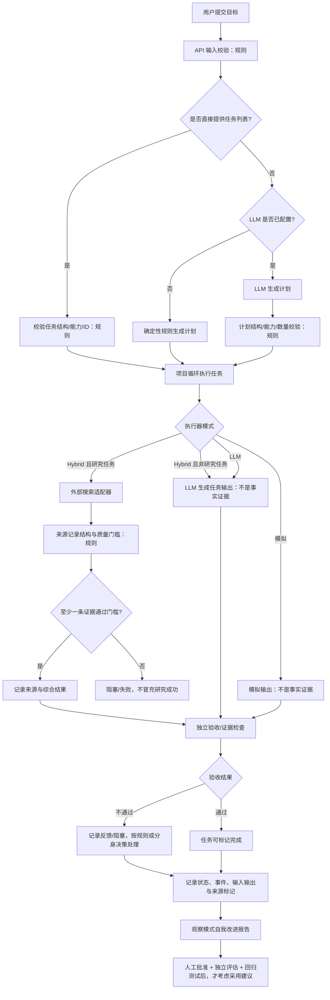

# 整体逻辑流程：规则与 LLM 在何时生效

> 本文以当前代码为准，区分“已经实现的确定性规则”“满足配置条件才会调用的 LLM/搜索”以及“尚未自动化的能力”。这是实现说明，不是理想化架构承诺。

## 1. 总体流程图

## 2. 一次请求中，规则和 LLM 的实际触发时机

| 阶段 | 规则/程序何时生效 | LLM 何时生效 | 重要边界 |
|---|---|---|---|
| 服务启动 | 检查环境变量；选择模拟或 Hybrid 执行器 | 只有 `JARVIS_LLM_BASE_URL`、`JARVIS_LLM_API_KEY`、`JARVIS_LLM_MODEL` 均有效时才创建 LLM 客户端 | 配置成功只代表可尝试调用，不代表服务商可用或输出正确 |
| API 入口 | 校验目标非空、长度上限、请求字段类型 | 不在此处自动调用 LLM | 不合法输入直接拒绝 |
| 计划生成（`/api/autonomous`） | 若请求提供任务，先校验任务结构、能力白名单、ID 唯一性等 | 没有提供任务且 LLM 客户端可用时，`plan_project` 调用 LLM；输出再经规则校验 | LLM 计划不是执行结果；异常或格式无效时回退到确定性计划 |
| 任务执行 | 项目循环控制迭代、状态和执行边界 | 取决于当前执行器和任务能力 | 当前项目循环与员工队列是相关但不同的两条执行入口 |
| 普通任务输出 | 检查输出非空、记录执行来源 | LLM/Hybrid 模式下由 LLM 执行器生成输出 | 模型自述、推理和引用文本不会自动变成外部证据 |
| 研究任务 | 检查搜索配置；验证来源记录结构、非模拟标记和质量门槛 | Hybrid 模式下研究任务先调用配置的搜索适配器；若有可用 LLM，可对通过门槛的来源做综合 | 缺少搜索配置或没有合格证据时应失败关闭，不以纯 LLM 回答替代搜索结果 |
| 失败后的重新规划 | 限制替代任务数量、检查重复 ID 和允许能力 | 只有存在 LLM 客户端且有失败任务时才调用恢复规划 LLM | 没有 LLM 或调用失败时不生成替代计划；不是无限自主循环 |
| 员工队列领取/心跳/租约 | 状态机、能力匹配、租约令牌、超时恢复、重试上限均由代码规则控制 | 心跳和领取本身不需要 LLM | LLM 不能绕过权限、租约和状态校验 |
| 结果验收 | 检查任务状态、输出格式、配置的成功条件与研究证据结构 | 当前验收不保证一定调用独立 LLM 评审 | 结构检查通过不等于语义正确；`verified_truth` 不会仅因结构验收而设为 true |
| 递归自我改进 | 对历史元数据做确定性统计，要求最小样本数并限制建议数量 | 当前观察报告生成本身不调用 LLM | 只给出可测试假设，不自动改计划、权限、代码或部署 |

## 3. 两条需要分清的执行路径

### A. 项目目标循环（`POST /api/autonomous`）

1. 校验目标和可选任务。
2. 如果用户没有提供任务，按配置选择 LLM 规划或确定性回退规划。
3. 通过当前执行器运行任务；失败时在满足条件时可请求 LLM 提出有限的替代任务。
4. 返回规划、任务报告、执行来源统计和记忆计数。

### B. 数字员工队列（`/api/workforce/*`）

1. 管理端创建任务；研究类能力默认启用证据要求。
2. 员工按 token 身份与能力领取任务，获得租约令牌。
3. 员工发送心跳、进度、输出或阻塞反馈；过期租约由监督器回收。
4. 结果先进入待验收状态，再由验收路径记录检查结果。
5. 失败、阻塞和重试需按状态机和重试上限处理。

这两条路径在服务中共存，但目前不能把它们误认为已经完全统一的单一调度器。后续端到端验收要分别测试，再验证二者之间需要的衔接。

## 4. 规则与 LLM 的职责边界

**确定性规则负责：**
- 输入校验、任务能力白名单、计划结构校验；
- 执行模式与风险门槛、权限、任务状态、租约、心跳、重试上限；
- 来源记录的结构性验证、输出验收条件、审计事件；
- 观察指标、最小样本门槛和改进建议数量限制。

**LLM 负责（仅在正确配置并实际调用时）：**
- 生成初始任务计划；
- 为失败任务提出有限的替代任务；
- 执行需要模型生成的任务内容；
- 在研究管线中，对已检索且通过结构/质量门槛的来源做辅助综合。

**LLM 不应被视为：**
- 权限或状态机的最终裁判；
- 搜索、实验、代码执行已经发生的证明；
- 事实真实性的独立验证器；
- 可以自行批准高影响操作、改权限或发布代码的主体。

## 5. 如何查看运行时到底走了哪条路径

1. 打开 `/trace`，连接管理员凭证，检查任务输入、输出、状态、历史事件、心跳和改进报告。
2. 查看 `/api/llm/status`：确认当前服务报告的执行模式和模型配置状态。
3. 查看 `/api/executor/status`：确认各能力被标记为 LLM、模拟、缺少真实适配器或其他状态。
4. 检查任务执行结果里的 `mode`、`simulated`、`trust_level`、`external_tools_used` 等字段。配置了 LLM 不代表每个任务都调用了 LLM；配置了搜索也不代表每个任务都完成了合格研究。
5. 对研究任务核对来源记录和质量检查；不能只看摘要或“任务完成”状态。

## 6. 当前已知限制 / 验收重点

- LLM 生成计划可以回退到确定性计划，但这不等于计划一定适合用户目标。
- 研究来源结构/质量门槛可以筛掉一部分明显无效数据，但不能单独证明来源可信、来源内容真实或证据语义上支持结论。
- 当前“递归自我改进”处于只读观察和提出实验建议阶段，不是自我修改代码或自动部署。
- 需要真实环境端到端测试才能确认模型供应商、搜索 provider、身份配置、队列状态和验收流程协同工作。
- 当前自动化测试绿灯只证明已覆盖的测试通过；不代表生产部署完成，也不代表外部事实已验证。

## 7. 对应代码入口

- `mvp/server.py`：服务启动、执行器选择、API 路由、项目循环入口。
- `mvp/planning.py`：LLM 规划、确定性回退、失败恢复计划及结构校验。
- `mvp/executor.py`：模拟、LLM、Hybrid 执行器与研究路由。
- `mvp/llm.py`：OpenAI-compatible LLM 客户端。
- `mvp/research.py`：搜索适配器、来源记录与研究综合。
- `mvp/workforce.py`：员工队列、任务状态、租约、反馈、证据门槛。
- `mvp/verification.py`：输出结构、来源和成功条件检查。
- `mvp/improvement.py`：只读的递归自我改进观察报告。
- `mvp/trace.html`：流程追踪、运行状态与改进建议的只读界面。
