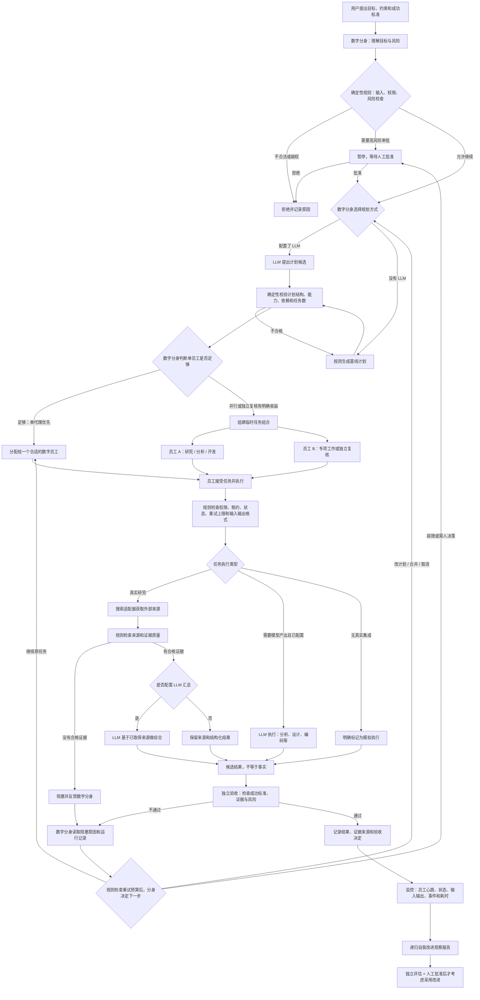

# 数字分身、数字员工、规则与 LLM：整体逻辑流程

> 本文区分“已存在的代码能力”和“目标中的完整闭环”。目前仓库中有自主项目循环、持久化员工任务系统和流程追踪页面，但这些路径还没有被端到端测试证明已完全统一。图中的目标流程不能当作已部署事实。

## 一、整体流程图

## 二、数字分身和数字员工分别做什么？

### 数字分身（目标负责人 / 动态协调者）

数字分身不应只是一个固定岗位的“AI 老板”，也不应该把所有决定交给 LLM。它负责维护目标与上下文、选择下一步行动，并根据执行反馈调整组织方式。

- **目标管理：** 把用户目标转化为可验收的成功标准；目标不清楚时提出澄清问题。
- **动态组织：** 先判断一个员工能否完成；只有并行、专长互补或独立复核有明确收益时才组建临时团队。
- **任务调度：** 创建任务、选择能力匹配的员工、维护依赖关系和优先级。
- **过程管理：** 读取员工的进度、心跳、输入输出、阻塞原因和证据；决定继续、重规划、合并、取消或升级给人。
- **结果把关：** 不把员工的“已完成”当作验收成功；依据独立验收结果向用户报告结论、证据和不确定性。
- **可追溯决策：** 记录为何拆分任务、为何选择员工、为何重规划，以及规则和模型分别贡献了什么。

### 数字员工（能力受限的任务执行者）

员工不是永久绑定某个现实职业的角色，而是带有运行身份、能力白名单、工具权限和状态的执行单元。

- 只领取符合自身授权能力、分配关系和任务状态的任务。
- 开始工作后记录进度与心跳；心跳只证明近期仍有响应，不证明工作正确。
- 提交候选输出、证据来源或阻塞原因；不得给自己的结果做可信验收。
- 根据数字分身的反馈继续、修正或重试；重试必须受次数、状态和权限规则约束。
- 输出需要区分真实工具结果、LLM 生成内容和模拟内容，不能混成一种“已验证事实”。

## 三、规则和 LLM 在什么时候生效？

| 节点 | 规则 / 代码 | LLM |
|---|---|---|
| 接收目标 | 校验字段、大小、权限和高风险动作 | 配置后可辅助澄清目标、提出成功标准 |
| 制订计划 | 校验 JSON、能力白名单、任务数、依赖和审批边界 | 配置并显式调用时，提出任务拆分与团队方案 |
| 选择员工 | 检查能力匹配、任务状态、租约和可用性 | 只有实现显式调用时，才可提供员工选择建议；不能授予权限 |
| 执行任务 | 工具权限、输入输出约束、状态机、重试上限 | 由已配置执行器调用，生成分析、设计、代码或研究综合 |
| 实时调研 | 搜索结果结构、HTTPS 来源、来源质量门槛 | 至少一条来源通过门槛后，才可基于来源进行综合 |
| 反馈和重规划 | 记录阻塞、限制循环次数、阻止非法状态迁移 | 可分析反馈并提出继续、合并、取消或重规划候选 |
| 独立验收 | 检查验收条件、证据记录、审批和验证者隔离 | 只有配置了独立审查器并实际调用时，才参与审查；不能自我批准 |
| 递归改进 | 统计重复阻塞、重试和验收失败 | 当前观察报告不调用 LLM、不改变任务或代码 |

**核心原则：规则管边界，LLM 提候选，数字分身做有记录的协调，数字员工负责执行，独立验收决定是否通过。** 对于高影响操作，LLM 的建议不能替代人工审批。

## 四、什么算真实的 LLM 调用？

只有当运行代码真正调用已配置的模型客户端时，追踪记录才应标记为一次 LLM 调用。至少应记录：

- 调用阶段：规划、员工执行、研究综合或重规划；
- 模型配置标签（不记录 API key 或其他秘密）；
- 脱敏后的输入/输出引用；
- 开始/结束时间、耗时、错误与回退路径；
- 输出来源标记：LLM 生成、外部工具返回、规则生成或模拟。

“环境变量已配置”“计划里写着要调用模型”“系统生成了看起来像 AI 的文本”，都不能单独证明真实 LLM 已被调用。

## 五、当前代码能力与尚待验证的边界

仓库已有的相关部件包括：

- 自主项目循环：有限轮次执行、可注入执行器、可选重规划器和高风险审批门槛；
- 持久化员工任务系统：任务创建、能力筛选、租约 token、进度/结果报告、反馈、重试、合并、取消和状态历史；
- 心跳与监控：员工状态、心跳时间、任务输入输出和事件追踪；
- 观察式递归改进：从历史元数据生成建议，不自动修改系统；
- 可配置的模拟、LLM、混合执行路径，以及实时研究适配器的接入边界。

尚不能声称已经完全实现的部分：

1. 自主项目循环创建的每个任务都自动进入持久化员工任务系统；
2. 数字分身的每个调度/重规划决定都能和员工事件在同一条时间线上关联；
3. 每个候选输出都经过真实、独立且语义层面的证据验证；
4. 当前运行环境已配置真实搜索服务和 LLM 凭据；
5. 已完成从用户目标到最终验收的浏览器端到端验收。

因此，下一项核心工程工作应当是**统一数字分身的目标/计划事件与持久化员工任务**，为每个任务记录 `goal_id`、`plan_version`、`decision_reason`，并在追踪页面上按同一时间线展示：分身决策 → 员工接受 → 进度/心跳 → 输出/阻塞 → 分身反馈/重规划 → 独立验收。

## 六、建议的验收流程

1. 提交一个目标，查看数字分身如何确定目标与成功标准。
2. 查看它为什么选择单员工，或为什么需要临时多员工协作。
3. 检查每项任务对应的员工、能力权限、输入、执行器模式和任务状态。
4. 确认真实 LLM 调用只在实际调用点出现，并能区分模拟输出。
5. 让员工返回阻塞或不合格结果，观察分身是否接收反馈并按规则决定重试或重规划。
6. 确认员工提交结果后进入待验收，而不是直接标记成功。
7. 查看独立验收依据、拒绝理由、重试上限和完整事件时间线。
8. 查看递归改进报告，确认它只提出建议，不会自行改动系统。
